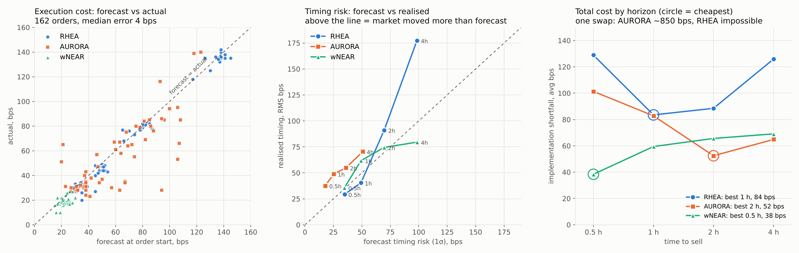

# Intents Execution Desk

An execution agent for DAO treasuries on [NEAR Intents](https://docs.near-intents.org/).
The DAO votes on a mandate in Sputnik DAO; the agent tells it how long the sale should take
(cost vs. timing risk), sells the position (for example RHEA -> USDC) in small slices instead of
one swap, waits for liquidity to come back between slices, never signs a quote that is far off
the market, sends the proceeds to the DAO, and reports the cost of execution (TCA).

Built at NEAR HACKATHON (Nov 1-14, 2026). Track: Unstoppable DeFi.

**Live dashboard:** https://intents-execution-desk.onrender.com
(free hosting; after a long idle period the first load can take up to a minute)

## The problem, in numbers

A project or DAO that needs dollars for salaries or runway sells its own token. One big swap
pays a large price impact, or does not go through at all. 1Click dry quotes, selling to USDC,
loss vs. the reference price including the 1Click fee (Oct 23-24, 2026):

| Size | wNEAR | RHEA | AURORA |
| --- | --- | --- | --- |
| $500 | ~0 bps | 140 bps | 152 bps |
| $5,000 | ~6 bps | 208 bps | 462 bps |
| $25,000 | ~11 bps | 503 bps | 1,550 bps |
| $100,000+ | ~22 bps | no liquidity | no liquidity |

On Nov 3, 2026 a $25,000 RHEA sell had **no quote at all** as a single swap.

## Evidence: 162 shadow orders, Nov 5-11, 2026

The worker ran an evidence series around the clock for six days: the same order at 0.5, 1, 2
and 4 hours, all four started at the same moment, then the next token. 41 batches, 162 orders,
all on live 1Click quotes (shadow mode: nothing signed). Raw data:
[`docs/evidence_series_orders.csv`](docs/evidence_series_orders.csv).



| | RHEA, $25k | AURORA, $10k | wNEAR, $25k |
| --- | --- | --- | --- |
| Batches | 14 | 14 | 13 |
| Avg implementation shortfall at 0.5 / 1 / 2 / 4 h, bps | 129 / **84** / 88 / 126 | 101 / 83 / **52** / 65 | **38** / 59 / 66 / 69 |
| One swap at the start | **no quote at all** (56 of 56 tries) | ~847 bps | ~26 bps |
| Execution-cost forecast, median error | 3 bps | 8 bps | 2 bps |
| Realised / forecast timing risk | 1.3x | 1.9x | 1.1x |

What this shows:

1. **The execution-cost forecast works.** Read off the impact curve when the order starts, it
   misses the realised cost by a median 4 bps over 162 orders (correlation 0.95). On longer
   horizons the agent beats it by a few bps: it has time to wait for good quotes.
2. **There is a best horizon, and it is not "as slow as possible".** Selling faster costs more
   impact; selling slower leaves the order exposed to the market. For RHEA the cheapest horizon
   was 1 h, for AURORA 2 h. That is the Almgren-Chriss trade-off the pre-trade analysis models.
3. **For an illiquid token the agent is the only way to sell.** $25k of RHEA had no quote as one
   swap in any of 56 tries; sliced, it sold at 84 bps on average (1 h). $10k of AURORA cost ~847
   bps as one swap and 52 bps over 2 hours: about **$790 saved per order**.
4. **For a liquid token it is not needed, and the agent says so.** wNEAR as one swap costs ~26 bps
   (mostly the 1Click fee); any schedule only adds timing risk. The pre-trade analysis recommends
   the single swap.
5. **The timing-risk forecast was too optimistic for AURORA (1.9x).** Volatility from 5-minute
   samples misses its jumps. Fixed on Nov 11: the agent now rescales each token's risk forecast
   by its own track record (RMS of realised / forecast timing, once it has 8 finished orders)
   and says so in the analysis. For AURORA this moves the recommendation towards shorter horizons.

Caveats. Orders in a batch share the same market, so the timing statistics rest on 13-14
independent batches per token, not 54. Shadow fills assume liquidity recovers between slices as
the next dry quote shows; the worst case (no recovery) is stored per slice and is close to one
swap. 158 of 162 orders sold 100%; four stopped at 70-96% when the deadline came (one from a
last-slice bug fixed on Nov 6), and by design the rest stays with the treasury.

**Earlier runs.** The first RHEA run (Nov 3) used $5k slices and sold 80% in 46 min at 128 bps.
Slice size now follows the horizon, the agent never trades ahead of schedule, and the free host
is kept awake from inside (it used to sleep and leave orders half sold).

## Try it

**On the live dashboard (no setup, no funds):**

1. Open the dashboard, expand **Start a shadow order** at the bottom.
2. Pick RHEA, $25,000, keep the limits, press **Analyze: how long should we take?**
   You see the pre-trade analysis: for each horizon the expected execution cost (from the impact
   curve measured right now), the 1-sigma timing risk and their sum, with a recommended horizon.
   Try wNEAR: it is liquid, and the analysis says a single swap now is cheaper than any schedule.
3. Pick a horizon, press **Start shadow order**. Wait a few minutes and the page refreshes itself: slices appear on the price chart, **Schedule
   vs sold** tracks the plan, and the **Decision log** explains every tick (`EXECUTE good quote`,
   `WAIT liquidity not recovered`, `WAIT quote worse than hard limit`...).
4. The TCA panel splits the cost into timing (the market moved) and execution (spread, impact,
   fees) and compares it with one swap at the start. **Results across orders** lists every
   finished order.

**With a Sputnik DAO (free, on testnet):** the agent watches the DAOs listed in `DESK_DAOS` and
turns each approved proposal that carries a mandate into an order, once:

```
execution-desk: {"sell": "RHEA", "usd": 25000, "hours": 2, "soft": 150, "hard": 250}
```

`python -m desk.cli dao-commands --account you.testnet --dao yourdao` prints the
[near-cli-rs](https://github.com/near/near-cli-rs) commands that create a faucet-funded testnet
account, a DAO with you as the council, the mandate proposal and the approving vote. Within a
minute of the vote the order appears on the dashboard with a link to the DAO. A Vote proposal is
an unfunded mandate (shadow order). On mainnet, a Transfer proposal that sends a NEP-141 token to
`intents.near` with `msg` = the agent account both approves and funds a live order.

**Locally:**

```
pip install -r requirements.txt
cp .env.example .env               # put a 1Click API key into ONECLICK_API_KEY
python -m desk.cli curve RHEA      # impact curve from dry quotes right now
python -m desk.cli pretrade RHEA --usd 25000   # cost vs timing risk by horizon
python -m desk.cli new-order RHEA --usd 25000 --to treasury.sputnik-dao.near --hours 2
python -m desk.cli run             # the agent; Ctrl+C and restart any time
python -m desk.cli status          # progress and TCA in the terminal
streamlit run ui/app.py            # the dashboard
pytest                             # 62 tests, no network needed
```

## How it works

```
Sputnik DAO --approved mandate--> agent (Render, 24/7)
                                                  |  benchmark: micro-mid from small dry quotes
                                                  |  policy: trade now or wait
                                                  |  guard: compare live quote with dry quote
                                                  v
                                           1Click API --solvers compete--> intents.near (settles)
                                                  |
                                     USDC goes straight to the treasury account
```

1. **Order.** Token, size, horizon, soft and hard limits (bps vs the benchmark), and the
   treasury account that receives the output. It comes from an approved Sputnik DAO proposal
   (`desk/dao/sputnik.py`), the dashboard or the CLI.
2. **Pre-trade analysis** (`desk/prices/pretrade.py`): the Almgren-Chriss trade-off. A faster
   sale needs bigger slices and each costs more (read off the impact curve); a slower sale risks
   the price drifting, 1-sigma timing risk = sigma * sqrt(T/3) for a linear schedule. Volatility
   comes from benchmark samples the worker records every 5 minutes (robust to single bad quotes),
   then rescaled by the token's own track record: realised vs forecast timing on finished orders.
   The recommended horizon minimises cost + risk; "one swap now" is one of the options, and for a
   liquid token it usually wins. Horizons that need slices faster than every 2 minutes are marked
   infeasible.
3. **Benchmark (micro-mid).** The reference price from `GET /v0/tokens` jumps by 40-100 bps
   while real depth stays flat, so the agent builds its own: dry quotes at $300, $1k and $3k,
   the 1Click fee added back, a straight line extended to size 0. Refreshed every 60 s.
4. **Impact curve and slice size.** At creation the agent quotes $500...$25k, picks the
   smallest slice that fits the horizon (about one slice per 5 minutes), capped by the soft limit.
5. **Policy, every 20 s** (`desk/engine/policy.py`): linear schedule ending at 90% of the
   horizon. Trade when not ahead of schedule and the quote is within the soft limit; trade
   anything within the hard limit when a full slice behind; never beyond the hard limit; at
   least 60 s between slices; after a slice, wait until the quote for the next slice comes back
   to its pre-trade level (liquidity recovered).
6. **Guard** (`desk/engine/guard.py`): on Oct 24, 2026 a live 1Click quote for 1,000 RHEA came
   back at 27.91 USDC while dry quotes said ~63.6, 56% worse. `slippageTolerance` does not catch
   that, it is measured from the quote itself. The agent compares every live quote with a fresh
   dry quote and the benchmark and refuses to sign if it is off.
7. **Execution (live mode):** live quote -> guard -> `generate-intent` -> NEP-413 signature by
   the agent key -> `submit-intent` -> `GET /v0/status`. The agent trades from its NEAR Intents
   balance (`depositType: INTENTS`), so there is no on-chain deposit per slice. Its account is an
   implicit account (hex of the ed25519 public key): no registration needed.
8. **Restarts:** the slice status is written before each external call; after a restart signed or
   submitted slices are reconciled through `/v0/status`, never sent twice (tested).
9. **TCA** (`desk/tca/metrics.py`): implementation shortfall = timing + execution, exactly,
   all in bps of the arrival price; savings vs one swap at the start.
10. **Evidence series** (`desk/series.py`): with `DESK_SERIES=RHEA:25000,AURORA:10000,wNEAR:25000`
   the worker runs the same shadow order at 0.5, 1, 2 and 4 hours, started together, then moves
   to the next token, around the clock. Every order keeps its pre-trade forecast, and **Results
   across orders** compares forecast and actual execution cost and timing risk by token and horizon.

## NEAR features used

- **NEAR Intents 1Click API:** dry and live quotes, `generate-intent` / `submit-intent`, status.
- **NEP-413 signing** in Python (`desk/near/signer.py`), checked on Oct 24, 2026 against
  `simulate_intents` on `intents.near`: a valid signature reaches the balance check, a corrupted
  one fails with `invalid signature`.
- **Implicit accounts** for the agent.
- **Sputnik DAO** governance: approved proposals are the only way a DAO order starts; the DAO
  receives every slice's output. Funded mandates use `ft_transfer_call` into `intents.near`.

## Limitations (read before trusting the numbers)

- **The demo runs in shadow mode.** Decisions use real 1Click dry quotes; fills are recorded at the
  dry quote and nothing is signed. The live path is implemented and tested against a simulated
  pool, but has not run with real funds.
- **Shadow mode cannot see the agent's own footprint.** Each shadow slice also stores a worst case
  (output if liquidity never recovered between slices); real execution lands between the two.
  When the cumulative size has no liquidity as one swap, the worst case is not available.
- **1Click is custodial for a moment:** funds sit with the 1Click deposit account during a swap.
- **The agent key lives on the server** (env variable). Keep only the order budget on it; the
  output goes straight to the treasury.
- **Timing cost includes our own footprint on thin markets**; splitting temporary and permanent
  impact is future work.
- **The demo DAO lives on testnet** (free); quotes are mainnet. Funded (Transfer) mandates are
  mainnet only and have not been run with real funds.
- **Volatility needs history:** until the worker has ~1 hour of samples for a token, the
  pre-trade analysis uses a default 1.5% per sqrt(hour) and says so. The risk forecast is
  rescaled only after 8 finished orders of that token.

## Layout

```
desk/
  config.py            settings from environment, asset ids
  oneclick/client.py   1Click API client
  near/signer.py       NEP-413 signing, implicit account
  prices/benchmark.py  micro-mid benchmark, impact curve
  engine/policy.py     adaptive TWAP decision per tick
  engine/guard.py      live-quote check before signing
  engine/desk.py       orders, ticks, shadow and live execution, restart reconciliation
  prices/pretrade.py   Almgren-Chriss horizon analysis, volatility estimate
  dao/sputnik.py       mandates from approved Sputnik DAO proposals
  series.py            evidence series: one order at several horizons, token after token
  near/rpc.py          read-only NEAR RPC
  tca/metrics.py       implementation shortfall, timing, execution, savings
  db/models.py         orders, slices, quotes, decision log (SQLite locally, Postgres on Render)
  worker.py, cli.py    always-on loop, command line
ui/app.py              Streamlit dashboard
start.sh, render.yaml  one free Render web service: worker + dashboard
.github/workflows/     backup keepalive ping (the service also pings itself every 4 min)
tests/                 unit and engine tests with a fake constant-product pool
```
